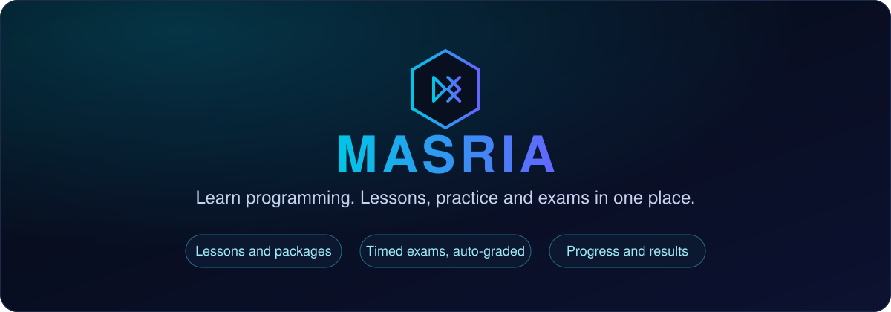

# MASRIA | ماسريا

**A bilingual learning platform for programming students, built by Eng. Kareem Ezz Eldin.**

Lessons, practice, timed exams and progress tracking in one place.

[Live platform](https://masria-academy.vercel.app) | Arabic / English | Mobile, tablet and desktop

---

## Preview

## What it is

MASRIA is a teaching platform for Egyptian Baccalaureate programming students. The teacher builds each lesson once, groups lessons into packages for each school year, and students follow their own progress, exams and results from their account.

## Features

**For students**
- Video lessons, files and review notes, organised by package
- Coding practice and timed exams with automatic grading
- Results, achievements, a leaderboard and homework
- Push notifications and offline support (installable PWA)
- Arabic and English interface with a dark, glass-style design

**For parents**
- A parent view of a child's exam results and achievements

**For the teacher (admin)**
- A lesson repository: create a lesson once, reuse it in several packages
- Packages per school year, each with a cover image
- Activation codes and package locking, plus discount codes
- Exams with question images, multiple choice and essay questions, and a review screen for essays
- Question bank and a follow-up dashboard for student activity
- WhatsApp message templates by student segment

## Built with

Next.js, React, TypeScript, Tailwind CSS, Firebase (Firestore, Auth, Security Rules), Vitest and Vercel. Student code runs in an isolated in-browser runner.

## About this repository

This repository is a public showcase only. The source code is private.

## Contact

Built and maintained by **Kareem Ezz Eldin** ([@Kareem569-coder](https://github.com/Kareem569-coder)).

MASRIA is also the name of a software-solutions company, with this platform as its education product.

&copy; 2026 MASRIA. All rights reserved.
